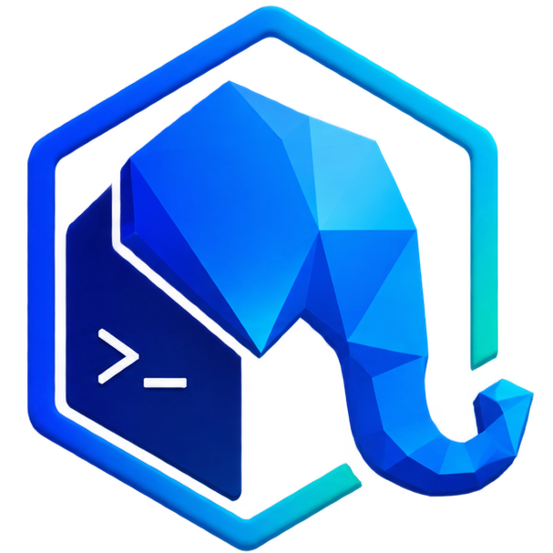
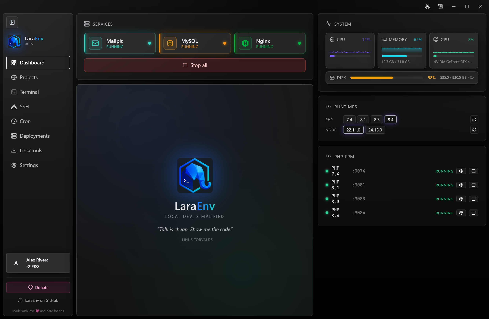
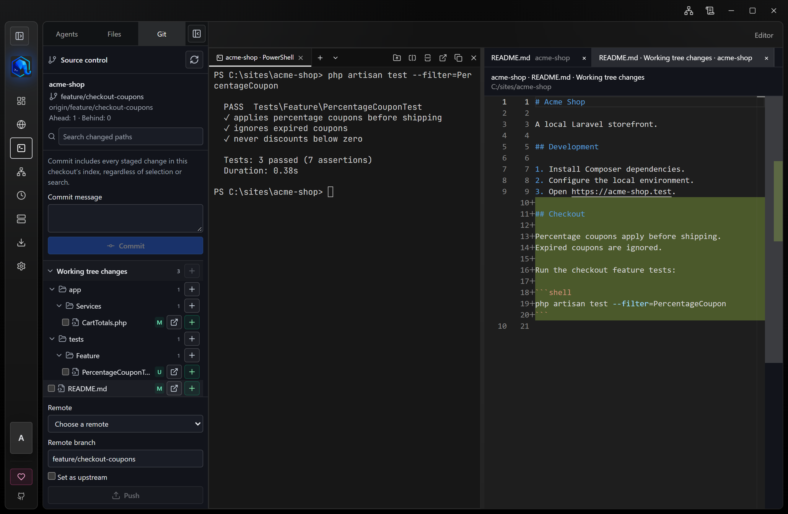

<p align="center">
  
</p>

<h1 align="center">LaraEnv</h1>

<p align="center">
  <strong>Your local development workspace for Windows.</strong><br />
  Build PHP/Laravel, Node.js and Python projects with your stack, terminals, files and Git in one place.<br />
  Open source, with local features available without a LaraEnv account or subscription.
</p>

<p align="center">
  <a href="https://github.com/thayronarrais/laraenv/releases"></a>
</p>

<p align="center">
  <a href="https://github.com/thayronarrais/laraenv/releases"><strong>Download for Windows</strong></a> ·
  <a href="docs/development.md">Build from source</a> ·
  <a href="https://laraenv.com">Website</a> ·
  <a href="https://github.com/thayronarrais/laraenv/issues">Issues</a>
</p>

<p align="center">
  
</p>

Screenshots show earlier versions and may include former Pro labels. Local features in the current source are available without a plan. See [historical screenshots](docs/historical-media.md) for context.

## Why LaraEnv?

- **One workspace for your day.** Start services, find a project, open a terminal, edit files and review Git changes together.
- **The runtime your project needs.** Keep PHP and Node.js versions side by side, detect project requirements and choose overrides when needed.
- **A home for Laravel.** Create projects, configure virtual hosts and local HTTPS, run package scripts, manage queue workers and schedule tasks.
- **SSH and deployments within reach.** Organize hosts and keys, connect from the terminal and apply reusable deployment recipes with local configuration and history.
- **Coding agents when you choose.** Enable optional agent sessions and local MCP tools for supported assistants.
- **Your environment, your code.** Use local features independently of LaraEnv Cloud, inspect the source and contribute under Apache-2.0.

Built for Windows with Go, Wails and React, LaraEnv brings your development tools into a native desktop application.

## A workspace that stays with your project

### Projects, runtimes and services

Browse projects by name, path or client tag. Open a project's details to choose PHP and Node.js, start its development processes, run scripts and inspect its setup with Site Doctor. Manage Nginx, Apache, Caddy, MySQL, PostgreSQL, Redis and Mailpit from the same environment.

<p align="center">
  
</p>

### Terminals, files and Git

Use PowerShell, CMD, Git Bash or Cmder in terminal tabs and split panes. Detach a terminal into its own window, browse files, edit text, preview Markdown and images, and stage, commit or push changes alongside your work.

<p align="center">
  
</p>

### Useful tools, close at hand

| Tool | What it helps you do |
| --- | --- |
| **Command Center** | Find actions, open projects and run commands with the palette or a configured global hotkey. |
| **Local HTTPS** | Manage local certificates and use HTTPS across supported project runtimes. |
| **Site Doctor** | Inspect project configuration and review individual repairs with visible output. |
| **SSH and deployments** | Manage hosts and keys, connect through saved hosts and apply deployment presets. |
| **Cron and workers** | Run project schedules and Laravel queue processes; eligible tasks can use Windows Task Scheduler. |
| **Optional agents and MCP** | Connect supported coding assistants to explicitly enabled local tools. |
| **Appearance and languages** | Choose a theme and use English, Portuguese, Russian or Simplified Chinese. |

Explore the [workspace](docs/workspace.md), [projects](docs/projects-workspace.md), [runtime detection](docs/project-runtime-detection.md), [SSH](docs/ssh-trust-and-passwords.md) and [MCP](docs/mcp.md) guides.

## Get started

Choose a package from [Releases](https://github.com/thayronarrais/laraenv/releases):

| Package | How to use it |
| --- | --- |
| **MSI installer** | Install the versioned `LaraEnv-<version>.msi`. Installed environments normally keep their data in `C:\laraenv`. |
| **Portable ZIP** | Extract `LaraEnv-<version>-portable-win64.zip` and keep `.laraenv-portable` beside `LaraEnv.exe`. Data stays in the extracted environment. |

The current source removes local account and plan gates. Existing binary releases can predate that change; read the selected release's notes before installing.

1. Install or extract the selected package in its own directory.
2. Open **Libs / Tools** and install the runtimes and services your project needs.
3. Start the services, then open or create a project from **Projects**.
4. Open the project in your browser, editor or integrated terminal and start building.

**Requirements:** Windows 10/11 x64 and a separately installed Microsoft WebView2 Runtime with Chromium 111 or newer. System integration, such as editing the Windows hosts file, needs administrator access. Keep portable copies separate from an installed environment.

Installed runtimes and local features can work without the LaraEnv API. Initial downloads, updates, remote Git, SSH and external providers need their respective networks and credentials. The optional cloud integration starts disabled; the hosted service is maintained separately. Read about [offline use and optional cloud](docs/desktop-offline.md).

The bare `LaraEnv.exe` release asset is an updater payload. Use the full MSI or portable package for installation, and check its SHA-256 sidecar.

## Open source and contributions

The desktop source is available here under [Apache-2.0](LICENSE). The cloud backend remains separately maintained and is not needed to build or use local desktop features.

```powershell
git clone https://github.com/thayronarrais/laraenv.git
cd laraenv
```

For a clean build, use Go 1.26.10, Node.js 24 or newer and the project's Wails 2.12.0 dependency graph. The [development guide](docs/development.md) covers setup, builds and tests; [RELEASING.md](RELEASING.md) covers packaging and release validation.

Read [CONTRIBUTING.md](CONTRIBUTING.md) to contribute code, report a reproducible bug or improve the docs. Translation catalogues and their guide live in [`desktop/langs/`](desktop/langs/); Russian and Simplified Chinese welcome native review. Report vulnerabilities privately through [SECURITY.md](SECURITY.md).

## Repository layout

| Directory | Contents |
| --- | --- |
| [`desktop/`](desktop/) | Wails application, Go tests, React frontend, translations and Windows packaging sources |
| [`internal/`](internal/) | Shared local services and integration packages |
| [`cmd/`](cmd/) | Standalone commands, including the SSH deployment TUI |
| [`docs/`](docs/) | Usage and development guides, release notes and screenshots |
| [`tools/`](tools/) | Build, translation, screenshot and license tooling |
| [`third_party/`](third_party/) | Dependency inventory, exact license texts and corresponding sources |

The single Go module stays at the repository root. Build helpers run the Wails project from `desktop/`.

## License

Original LaraEnv desktop code is licensed under Apache-2.0. Third-party components retain their own licenses; see [NOTICE](NOTICE), [THIRD_PARTY_NOTICES.txt](THIRD_PARTY_NOTICES.txt) and the [licensing guide](docs/licensing.md). Separately downloaded runtimes have their own terms.
