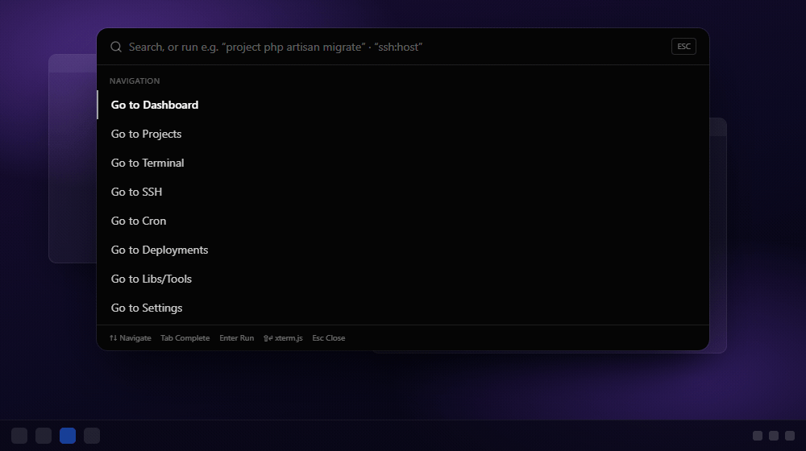
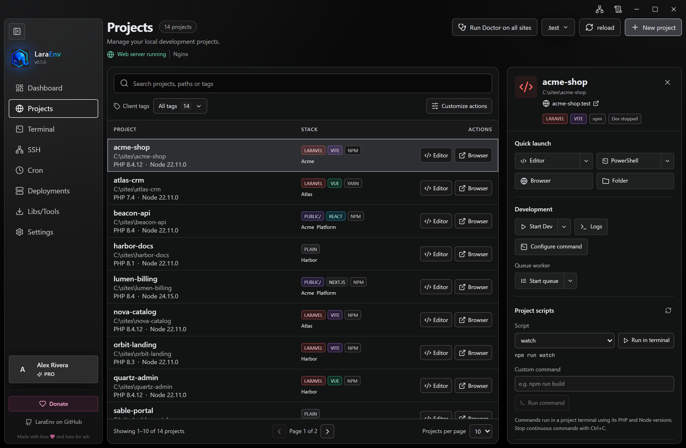
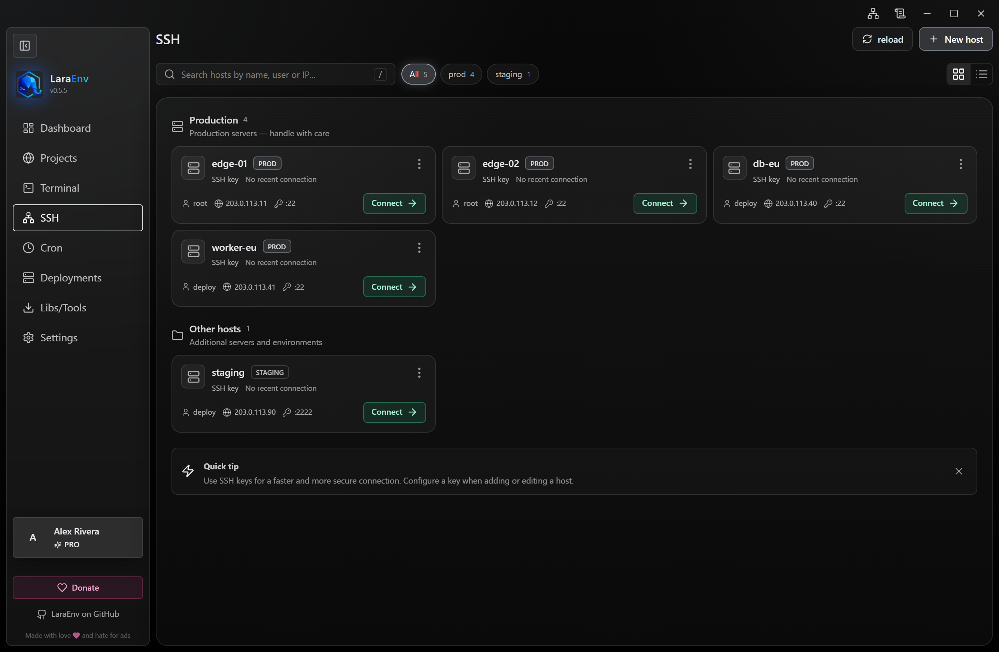
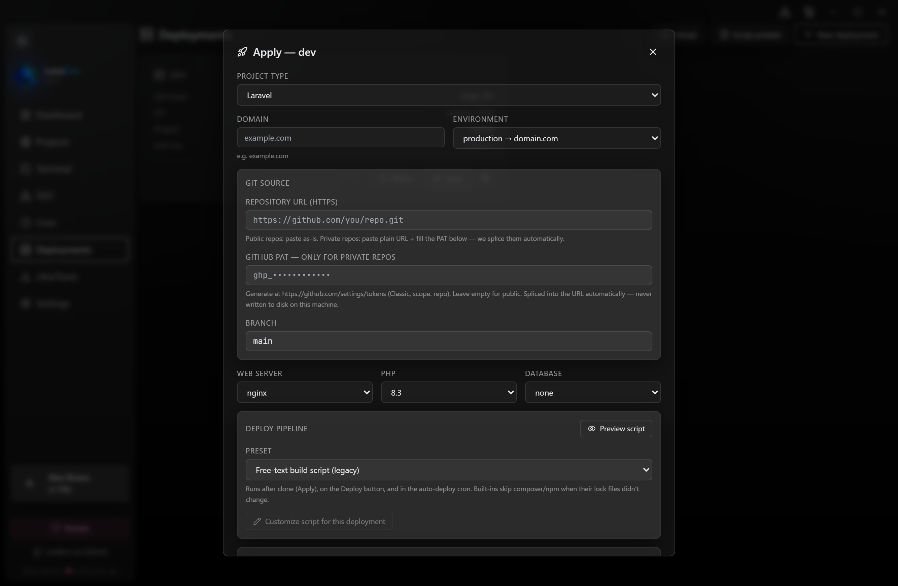
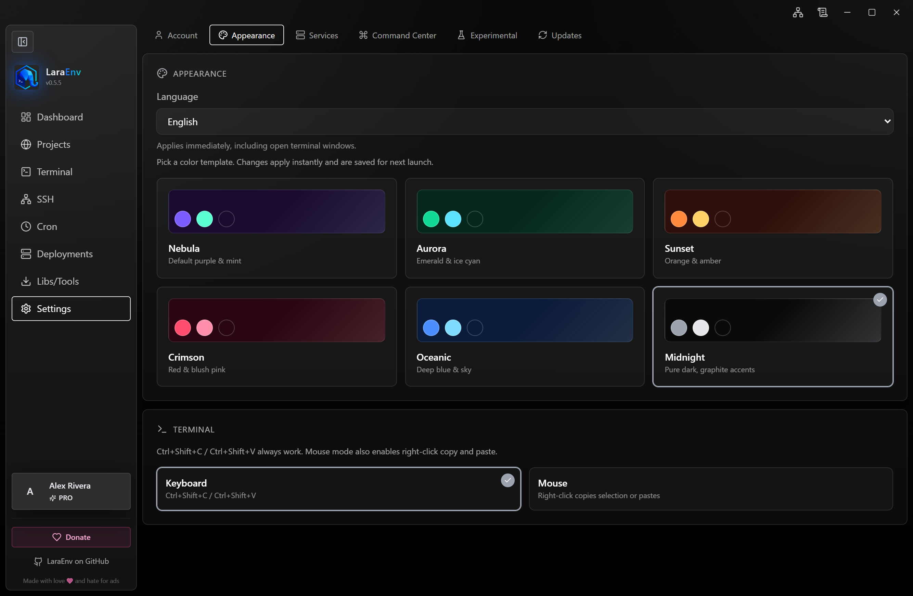

<p align="center">
  
</p>

<h1 align="center">LaraEnv</h1>

<p align="center">
  <strong>The ultimate development environment for Windows.</strong><br/>
  Replace Laragon or Herd with a more flexible, multi-runtime, and visually stunning tool.<br/>
  Built with <a href="https://wails.io">Wails</a>, Go, and React. Native binary, no Docker, no WSL, no Electron.
</p>

<p align="center">
  <a href="https://github.com/thayronarrais/laraenv/releases/latest"></a>
  <a href="https://github.com/thayronarrais/laraenv/releases"></a>
  
  
  
</p>

<p align="center">
  <a href="https://github.com/thayronarrais/laraenv/releases/latest"><strong>⬇️ Download MSI</strong></a> ·
  <a href="https://laraenv.com">🌐 Website</a> ·
  <a href="https://laraenv.com/pricing">💎 Pro</a> ·
  <a href="https://github.com/thayronarrais/laraenv/issues">🐞 Issues</a>
</p>

<p align="center">
  
</p>

---

## Why LaraEnv?

- **Native Windows app** running on WebView2.
- **One workspace for shells, agents, files and Git** — browse files, preview Markdown, edit text, review diffs, stage changes, commit and push.
- **Optional local MCP** — register Claude Code, Codex or Cursor from Settings and let assistants work with your local environment.
- **Multi-runtime out of the box** — PHP 5.6 → 8.5 side-by-side (8.6 available as a beta), multiple Node versions, Python 3.13.
- **Project requirements detected automatically** — choose compatible PHP/Node installations from version files and manifests, or keep a manual override.
- **Projects organized by client tags** — compact rows, visible search, pagination, a separate details panel and customizable row shortcuts.
- **Project scripts and commands** — run the scripts in `package.json` or enter a custom command from the details panel, with output in a project-aware terminal.
- **Optional Agent map** — inspect observed agents and background tasks for a selected session, with shared activity in the main and detached workspaces.
- **Site Doctor** — review setup across many projects, separate actionable findings from optional suggestions, and run individual repairs with output.
- **Real services, not containers** — Nginx, Apache, Caddy, MySQL, PostgreSQL, Redis, Mailpit. Installed and started by the app.
- **Pro tier** — zero-knowledge cloud sync of your SSH keys / cron jobs and one-click VPS deploys.

---

## Download

**Latest release: [v0.5.7](https://github.com/thayronarrais/laraenv/releases/tag/v0.5.7).** Read the [release notes](docs/releases/0.5.7.md).

Two editions, same application.

| Edition | What you get |
|---|---|
| **[Installer (MSI)](https://github.com/thayronarrais/laraenv/releases/latest)** | Recommended. Installs to `%ProgramFiles%\LaraEnv\`, Start Menu and Desktop shortcuts, clean uninstall via Control Panel. Your projects, databases and config live in `C:\laraenv` and survive uninstalling. |
| **[Portable (ZIP)](https://github.com/thayronarrais/laraenv/releases/latest)** | `LaraEnv-x.y.z-portable-win64.zip`. Extract anywhere and run &mdash; nothing is installed. The entire environment (config, projects, PHP, Nginx, MySQL) lives inside the extracted folder, so it travels with you and leaves nothing behind. |

Every asset ships with a `.sha256` sidecar. The in-app updater verifies against it before installing, and a portable copy refuses to update at all without one.

**Portable, in one line:** what makes it portable is the `.laraenv-portable` file next to `LaraEnv.exe`. Keep it. Extract somewhere that will not collide with `C:\laraenv` &mdash; Windows ignores letter case, so `C:\LaraEnv` is the *same folder* as the installed location.

A portable copy also leaves the machine's certificate store alone. Local HTTPS needs a certificate authority Windows trusts, and installing one is a real change to a computer that may not be yours &mdash; so a portable copy asks instead of doing it silently: **Settings &rarr; Services &rarr; Local HTTPS**. An installed copy still sets it up automatically, as it always has.

**Requirements:** Windows 10/11 x64 · WebView2 Runtime (preinstalled on Win 11) · Administrator rights on first launch (to write `C:\Windows\System32\drivers\etc\hosts`).

All versions are on the [Releases page](https://github.com/thayronarrais/laraenv/releases). The in-app updater checks for new releases automatically and verifies them with SHA-256 before installing.

The **0.5.7** release upgrades public **0.5.6** normally. If you installed a local test MSI numbered **0.5.7 or higher**, uninstall that test application before installing public 0.5.7 to avoid conflicts with the test MSI version. Preserve `C:\laraenv`, your portable folder and project/database data. Those test builds were not public releases. Close LaraEnv before installing.

---

## Features

### New in v0.5.7

- **SSH trust and saved passwords:** integrated connections share host-key verification, while Windows DPAPI protects saved SSH passwords and preserves recovery information when a portable environment moves to another account.
- **Local HTTPS across runtimes:** PHP and new Node project processes can use the public local CA while preserving custom trust settings. Existing CA material is retained.
- **Optional Laravel evidence through MCP:** bounded daily/single logs, read-only project-attributed Mailpit messages, and a diagnostic prompt/resource. The metadata collector is experimental, requires explicit installation and local activation, and has been validated with Laravel 12; other framework versions and Octane remain unverified.
- **Windows startup and workspace fixes:** WebView2 recovery, terminal shells created on first use, HTTPS controls, and more room for the project workspace.

Guides: [SSH trust and passwords](docs/ssh-trust-and-passwords.md) · [HTTPS across runtimes](docs/https-runtime-trust.md) · [MCP and Laravel evidence](docs/mcp.md).

### Introduced in v0.5.6

- **Scripts in the project panel:** choose from the scripts declared in `package.json`, including `dev`, `watch`, `build` and custom names when present. Refresh the list after editing the manifest.
- **Custom commands:** run another command in a new integrated terminal with the project's shell, PHP, Node and package manager. Task output stays visible; use Ctrl+C to stop a continuous script.
- **Development controls restored:** projects with `package.json` can use the managed Dev server even without a recognized framework. Laravel queue controls remain visible independently of Node scripts.
- **Agent map:** open observed descendants and background tasks from the activity counter or a session's **View map** action. Main and detached workspaces share the same activity snapshot.

Scripts and custom commands do not change the saved Dev command. A task such as `build` receives no automatic server arguments such as `--port`.

Agent sessions are optional under **Settings → Experimental**. Claude Code and Codex coverage depends on the available protocol and trusted hooks; Kimi and OpenCode report child observation as unavailable. Activity stays in memory for the current run, and missing model, duration or token data remains unavailable.

### Introduced in v0.5.5

- **Projects:** compact list, search by name/path/tag, client-tag counts, pages of 10/20/50 and one selected project's details panel. Colors follow the selected theme.
- **Your row shortcuts:** choose and order editor, browser, terminal or folder, hide either slot and save the preference on this device.
- **Automatic PHP and Node:** detect version files and manifest requirements, show the version and its source, and link missing compatible runtimes to Downloads. Manual choices remain available.
- **Site Doctor:** inspect one or all projects, filter by health, review findings and run individual repairs. Laravel storage links are optional; inconclusive checks remain unverified.

Guides: [Projects](docs/projects-workspace.md) · [Runtime detection](docs/project-runtime-detection.md) · [Site Doctor](docs/site-doctor.md).

The workspace with **Agents / Files / Git**, Markdown and image previews, stage/unstage/commit/push, optional local MCP and deployment database access shipped in [0.5.4](docs/releases/0.5.4.md). See [Workspace](docs/workspace.md), [MCP setup](docs/mcp.md) and [Deployment database access](docs/deployment-database-access.md).

| | |
|---|---|
| ⌨️ **Command Center** | Spotlight-style command palette. Press **Ctrl+K** in-app — or a configurable **global hotkey** that summons it even when LaraEnv is hidden to the tray. Navigate pages, start/stop services, open projects, scaffold new ones, and type-to-run `php artisan` / `npm` in any project. Save your own commands with custom hotkeys. |
| 🚀 **Multi-runtime** | PHP 5.6 → 8.5 + multiple Node versions + Python 3.13 in parallel. Detect PHP/Node requirements automatically or use per-project overrides. Each PHP version gets a shared FPM pool on its own port (9074 for 7.4, 9085 for 8.5, etc). PHP 8.6 is offered as a **beta** and has no stable release or PECL builds in the catalog. |
| 🧩 **PHP extensions** | Install Xdebug, Redis, MongoDB, APCu, Imagick or Memcached into any PHP version from the gear beside its FPM entry — the right build for that version, no hunting for DLLs. Swoole is not offered: it needs `epoll`/`kqueue` and has no native Windows build, so on Windows the route is WSL. |
| 🌐 **Web servers** | **Nginx, Apache and Caddy**, with config auto-generated per project for whichever ones you install — switching between them needs no regeneration. Only one serves at a time; starting a second tells you which is already holding port 80 instead of failing at the socket. Per-project SSL is signed by a local CA the browser trusts, and all three share the same certificates. |
| ⚙️ **Web server tuning UI** | Edit `client_max_body_size`, `fastcgi_read_timeout`, `proxy_read_timeout`, `worker_connections`, hash sizes — and Apache `Timeout`, `KeepAliveTimeout`, `LimitRequestBody`, `ProxyTimeout`. Saves rewrite the live config and reload the running service. Fixes 504-on-slow-uploads in dev. |
| 🗄️ **Databases** | MySQL **and** PostgreSQL with first-run init (`mysqld --initialize-insecure`, `initdb`). Auto-create the project DB and patch `.env` for Laravel scaffolds. |
| 📨 **Mail + cache** | Mailpit (SMTP catcher with UI on `:8025`) and Redis ready to start with one click. |
| 💻 **Terminal** | PowerShell, CMD, Git Bash, Cmder. Multi-tab plus **split panes** (horizontal and vertical) and a **floating-groups workspace** — tear a tab off into its own always-on-top window and dock it back later. Tabs persist across page navigation. cwd and PATH wired to the active project's PHP/Node. |
| 🔌 **Ports manager** | List every process listening on a port and **kill it in one click** — no more hunting for a stray `node`/`php` holding `:5173` or `:8000`. |
| 📜 **Service logs** | Live log viewer per service (Nginx / Apache / MySQL / PHP-FPM …), with a running badge in Libs/Tools so you can see what's actually up. |
| 🔐 **SSH manager** | ED25519 / RSA-4096 / ECDSA-P256 key generation, key import, host registry with tags, **ProxyJump** + ProxyCommand, latency + version probe, in-app interactive shell. |
| ⏰ **Cron** | 5/6-field expressions plus descriptors (`@hourly`, `@daily`). Per-job project context (PATH + cwd). Output captured into the UI. **Opt-in: run jobs even when LaraEnv is closed** via Windows Task Scheduler. |
| 📊 **System monitor** | Live CPU, Memory, GPU gauges with sparklines, plus a system-drive **Disk** progress bar. Sampled every 1.5 s. |
| 📁 **Projects** | Auto-detects type (Laravel / WordPress / plain), JS framework (React / Vue / Next / Nuxt / Astro), and package manager (npm / yarn / pnpm / bun). Run declared scripts and custom commands from the selected project's panel. Templates: blank, Laravel, WordPress, Git clone, Vite, Next, Nuxt, Astro. |
| 🏷️ **Tags + filtering** | Free-form labels per project, a searchable client-tag filter with counts, and project search/pagination. SSH hosts also support tags. |
| 🩺 **Site Doctor** | Inspect project setup and runtime requirements, filter an all-project overview by health, and run available repairs individually. Optional suggestions and skipped checks are shown separately. |
| 🔧 **Vhost editor** | Inline edit of the generated `nginx.conf` / Apache vhost with syntax highlighting. Reset-to-template in one click. |
| 🔁 **Reverse proxy** | Per-project proxy port for Vite / Next / Nuxt dev servers. WebSocket headers included so HMR works through the proxy. |
| ☁️ **Cloud sync (Pro)** | Zero-knowledge AES-256-GCM with Argon2id-derived keys — your SSH hosts, keys, cron jobs, and themes sync across machines without the server ever seeing the plaintext. |
| 🚢 **One-click deploy (Pro)** | Provision a VPS from a saved SSH host: install PHP / Nginx / MySQL / Node, configure vhost, issue Let's Encrypt cert, optional auto-deploy via remote `git pull` cron. |
| 🎨 **6 themes** | Nebula, Aurora, Sunset, Crimson, Oceanic, Midnight. |
| 🔄 **Auto-update + system tray** | In-app check, MSI download, SHA-256 verify, install. Hide to tray and keep services running. No telemetry. |

---

## A tour through the app

### Dashboard

Live status of every service, the runtimes you have installed, the PHP-FPM ports in use, and a real-time system monitor (CPU / Memory / GPU + Disk). Start everything with **Start all** or pick services individually.

<p align="center">
  
</p>

### Command Center

A keyboard-first launcher for the whole app, in the spirit of Spotlight / VS Code's command palette.

<p align="center">
  
</p>

<p align="center">
  <sub>Name a project and ask for <code>php artisan</code> or <code>npm run</code> — the suggestions are read from that project, not from a fixed list.<br/>
  The global hotkey in the clip is one you set yourself; it ships disabled.</sub>
</p>

**Opening it**

- **Ctrl+K** — opens the palette inside the app window (the in-app hotkey is configurable in **Settings → Command Center**).
- **Global hotkey** — set an OS-wide shortcut (e.g. `Win+Shift+K`) and the palette pops up as a standalone Spotlight-style bar **even when LaraEnv is hidden to the system tray**. It opens already focused, so you can start typing immediately. Configure it in **Settings → Command Center** (empty = disabled).

**What you can do**

Just start typing — results are fuzzy-filtered and grouped:

- **Navigation** — jump to any page (`Dashboard`, `Projects`, `Terminal`, `SSH`, `Cron`, `Deployments`, `Libs/Tools`, `Settings`).
- **Services** — `Start all`, `Stop all`, `Reload web stack`, or start/stop/reload any individual service.
- **Projects** — open a project's folder, editor, or browser; or scaffold a new one (`New Laravel project`, `Clone from Git`, `New Vite project`, …) — selecting it opens the New Project form pre-filled to that type.
- **Custom commands** — save your own (a terminal command, a service action, or a navigation) and optionally bind each to its own hotkey.

**Run commands in a project (launcher mode)**

Type a project name followed by a command and the palette switches into launcher mode:

```
myapp php artisan migrate
myapp npm run dev
```

`artisan` sub-commands and `npm` scripts for that project autocomplete as you type — press **Tab** to complete the highlighted suggestion. You can also type `ssh:<host>` to open a saved SSH host. Tip: highlight an **Open terminal · <project>** row and press **Tab** to drop the project name into the input, ready for a command.

**Keys**

| Key | Action |
|---|---|
| `↑` / `↓` | Move selection |
| `Tab` | Complete the highlighted token / project |
| `Enter` | Run — opens terminal commands in the **native** external terminal |
| `Shift+Enter` | Run terminal / SSH commands in the **in-app xterm.js** tab instead |
| `Esc` | Close |

### Projects

The compact list shows project name, path, runtime summary, stack and tags. Search, client-tag filtering and pagination keep large collections manageable. Choose your row shortcuts and select a project to open quick launch, runtime choices, Dev/queue controls, package scripts, custom commands and project tools in its details panel. The TLD remains configurable globally.

PHP pools are shared by version and the web server is shared across sites. Dev and queue controls operate the selected project's processes. Run Doctor to inspect configuration health; a shared running server does not prove each application works. Read the [Projects guide](docs/projects-workspace.md).

<p align="center">
  
</p>

The **Project scripts** selector reads `package.json` and runs the chosen script with npm, pnpm, Yarn or Bun as resolved for that project. A custom command can also run in the project directory. Both open a new integrated terminal using the saved shell and runtimes. Managed Dev controls have their own command and logs; Laravel projects also have queue-worker controls and arguments.

<p align="center">
  
</p>

### Terminal

A real ConPTY terminal — not a fake one. Multi-tab, with split panes (`split →` horizontal, `split ↓` vertical). Each pane is a real session with persistent layout per tab. PowerShell, CMD, Git Bash, Cmder. **Tear any tab off into its own floating, always-on-top window** and dock it back when you're done — the layout is remembered between launches. Shells spawn with the live Windows PATH and honour each project's PHP/Node version.

<p align="center">
  
</p>

### SSH

Manage hosts, generate or import keys, test connections (TCP + handshake + version probe). Connect with one click — the session opens in the Terminal page. Filter by tag. Supports **ProxyJump** through any saved host (no credential re-entry) and an advanced **ProxyCommand** field for tools like `cloudflared access ssh`.

<p align="center">
  
</p>

### Cron

Per-project schedules with output capture. Toggle **"Run when LaraEnv is closed"** on a job to register it with Windows Task Scheduler — the runner re-evaluates the cron expression every minute, so any robfig-compatible schedule works without translation.

### Deployments *(Pro)*

Pick a saved SSH host, choose project type, web server (Apache or Nginx), database (MySQL or PostgreSQL), PHP version, optional Let's Encrypt HTTPS, and a build script — with **reusable script presets and variables** so common deploy recipes are one selection away. Hit **Deploy now** to push on demand, or let auto-deploy run a remote crontab that polls `git pull` at your chosen interval. Re-applying config is `.env`-safe and **preserves `storage/`** across runs. An activity log of every apply / pull is kept per deployment.

<p align="center">
  
</p>

### Libs / Tools

A curated catalog of every runtime and service the app supports — install with one click. PHP 5.6 to 8.5 (8.6 as a beta), Node LTS + Current, Python 3.13, Nginx, Apache, Caddy, MySQL, PostgreSQL, Redis, Mailpit, Cmder.

### Settings

- **Account** — log in to LaraEnv Cloud (email/password or GitHub OAuth), see entitlements, manage billing.
- **Appearance** — pick one of 6 themes, terminal copy mode.
- **Command Center** — set the in-app palette hotkey and the OS-wide global hotkey, and manage your saved custom commands.
- **Services** — tuning UI for Nginx and Apache (`client_max_body_size`, timeouts, `LimitRequestBody`, etc). Caddy has none: its config is short enough to edit directly in the built-in editor, which opens any of the three.
- **Local HTTPS** — shows the local certificate authority, whether Windows trusts it, and a button to install it. A portable copy never installs it on its own; on a machine that is not yours, that is a deliberate choice, not a side effect of opening the app.
- **Updates** — manual check, download, and install the latest MSI.

<p align="center">
  
</p>

---

## Free vs Pro

|  | Free | Pro |
|---|:---:|:---:|
| Full local stack (PHP / Node / Nginx / Apache / MySQL / PostgreSQL / Redis / Mailpit) | ✅ | ✅ |
| Multi-PHP / multi-Node side-by-side | ✅ | ✅ |
| Project scaffolding & vhost management | ✅ | ✅ |
| Command Center (palette + global hotkey + custom commands) | ✅ | ✅ |
| SSH manager with ProxyJump | ✅ | ✅ |
| Cron with Task Scheduler integration | ✅ | ✅ |
| 6 themes & auto-update | ✅ | ✅ |
| **Cloud sync (zero-knowledge)** of SSH hosts, keys, crons | — | ✅ |
| **One-click VPS deploys** with Let's Encrypt | — | ✅ |
| **Auto-deploy on git push** | — | ✅ |
| Web dashboard at [laraenv.com/dashboard](https://laraenv.com/dashboard) | ✅ | ✅ |

**LaraEnv Pro — $3 / month.** Subscribe via Stripe or PayPal at [laraenv.com/pricing](https://laraenv.com/pricing). Cancel anytime.

---

## Quick start

1. Grab the installer or the portable ZIP from the [latest release](https://github.com/thayronarrais/laraenv/releases/latest). The MSI installs; the ZIP just runs.
2. On first launch, open **Libs/Tools** and install the runtimes you need (e.g. PHP 8.5, Node 22, Nginx, MySQL).
3. Hit **Start all** on the Dashboard.
4. Open **Projects** → **New project**, pick a template, give it a name. Vhost, hosts entry, and SSL are generated automatically.
5. Browse to `https://your-project.test`.

---

## Translations

The interface ships in four languages. Pick one in **Settings → Appearance**;
it applies immediately, including terminal windows you have already detached.

| Language | Code | |
|---|---|---|
| English | `en` | |
| Português (Brasil) | `pt-BR` | |
| Русский | `ru` | needs native review |
| 简体中文 | `zh-CN` | needs native review |

Russian and Simplified Chinese were written **without a native speaker**. They
are structurally sound — key coverage, placeholders and plural forms are all
checked — but nobody who speaks either language has read them for tone. The app
says so in the language selector, and the marking exists to be removed by
whoever reviews one.

### Edit the text yourself, without waiting for a release

Every string lives in [`langs/`](langs/) as plain JSON, and the app reads a
`langs/` folder in its install root on top of what it ships with.

```
C:\laraenv\langs\pt-BR.json          installed copy
<extracted folder>\langs\pt-BR.json  portable copy
```

Edit a file, restart the app, see it. Three things make this practical:

- **Partial files work.** Override three strings and the rest falls back to
  what shipped. You do not need a complete catalogue to change one button.
- **A language nobody has contributed appears just by existing.** Drop in
  `de.json` with a `$meta` block and German is in the selector.
- **Mistakes are survivable.** A file that cannot be read, or is named
  something that is not a language code, is skipped — the app tells you which
  and why in Settings, and starts normally.

Use it to fix a word that bothers you, to try a wording before proposing it, or
to run LaraEnv in a language that does not exist yet.

### Contributing a translation

Fork, copy `en.json` to `<code>.json`, translate the values, open a pull
request. CI checks your file and tells you what is missing — including the
plural forms your language actually needs, which it reads from CLDR rather than
a hand-written list.

Reviewing an existing translation counts, and is a smaller job than starting
one. If you speak Russian or Chinese, correcting what is there — and removing
the review flag in the same pull request — would be very welcome.

[`langs/README.md`](langs/README.md) has the full guide and the rules CI
enforces. No install step is needed to check your own work.

## Status

Used daily by the author. Bugs, feature requests, and screenshots are welcome on the [issue tracker](https://github.com/thayronarrais/laraenv/issues).

## License

Desktop releases are free to use. This public repository contains binary releases, user documentation, translation catalogues and the issue tracker. Desktop source is maintained in the separate private builder repository; the cloud server source is also private. This repository does not provide the desktop or server source tree.

---

This repository hosts the **binary releases** of the LaraEnv desktop app. Marketing, accounts, billing, and the Pro API live at [laraenv.com](https://laraenv.com).

Made with ❤️ and hate for ads.
