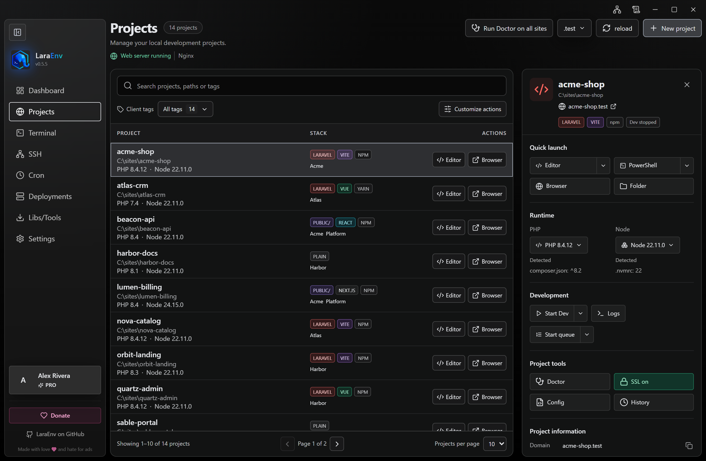
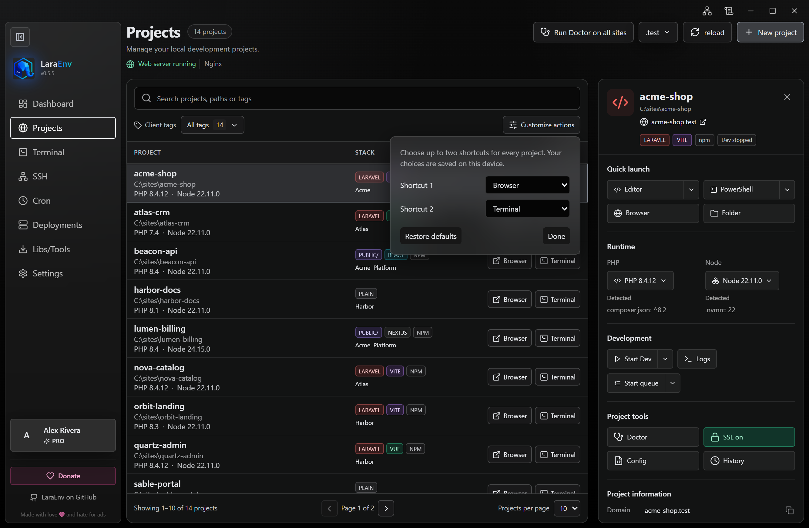

# Projects

Projects uses a compact list for your local sites and a separate panel for the selected project's tools. Each row shows its name, path, stack and tags. Row shortcuts launch your preferred tools; selecting the row opens its details.

## Find a project

Search by name, path or tag. **Client tags** is the main grouping filter and shows the number of projects associated with each tag. **All tags** includes every project; **Untagged** finds projects without a tag. Tags remain free-form labels, so you can use them for clients, teams or other categories. Search inside the tag picker or select a tag shown in the list.

Search and tag filters can be combined. **Clear filters** restores the complete list. Choose 10, 20 or 50 projects per page; the footer shows the visible range and matching total. Changing the search, tag or page size adjusts pagination.

The details panel follows one project visible on the current page. Filtering it out, moving to another page or deleting it clears the selection.

## Choose your row shortcuts

Use **Customize actions** to select the two row shortcuts: editor, browser, terminal or folder. Select **Hidden** to leave either slot empty. The order and choices apply to all projects and are saved on this device. They do not create new project runtime or application preferences: editor and terminal shortcuts use your existing choices.

Choosing an action already used in the other slot swaps the slots. **Restore defaults** returns to editor and browser. If saving is unavailable, the interface reports that the current preference could not be saved.

The list, selected row, buttons and details panel follow the theme selected in Settings.

## Use the details panel

The panel groups **Quick launch**, **Runtime**, **Development**, **Project tools** and **Project information**. Copy the project path or domain, open its browser, folder, editor, terminal or agents, and use the editor and terminal menus to change their existing preferences.

Runtime selectors show effective PHP and Node versions, the source of each choice and declared requirements. Choose **Automatic** or an installed version. When a compatible runtime is missing, open the filtered Downloads page. See [runtime detection](project-runtime-detection.md).

Development controls start or stop the selected project's Dev server and queue worker, show logs and expose the existing proxy, command and queue-argument settings. Project tools include SSL, virtual-host configuration, cron/history, tags and [Site Doctor](site-doctor.md). New-project creation, domain suffix selection, reload and deletion remain available.

In wide windows the panel sits beside the list. In narrower windows it opens over the list. Close it with **Close project details** or Escape; keyboard focus stays inside the open overlay and returns to the list when it closes.

## Understand the status

**Web server running/stopped** describes the shared web-server process. PHP pools are also shared by version and can serve several projects. PHP and Node version choices remain per-project configuration.

The **Dev** server and queue worker belong to the selected project. Their Start and Stop buttons control those specific processes. For configuration health, run **Doctor**; its report distinguishes findings requiring attention, optional suggestions and checks that could not be completed. Web-server availability does not by itself prove that an individual application is healthy.
