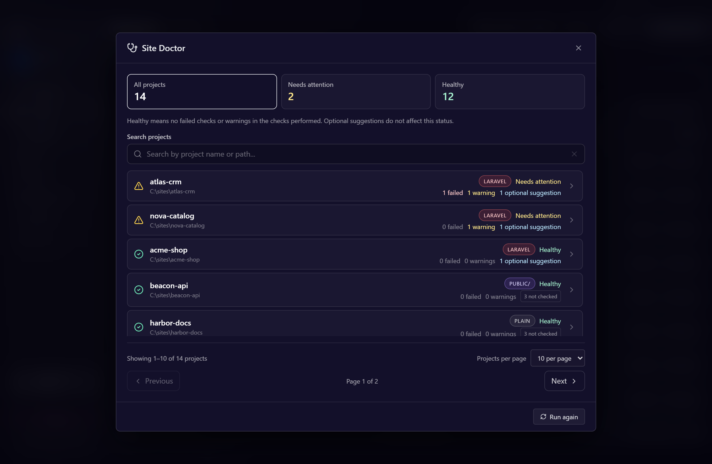
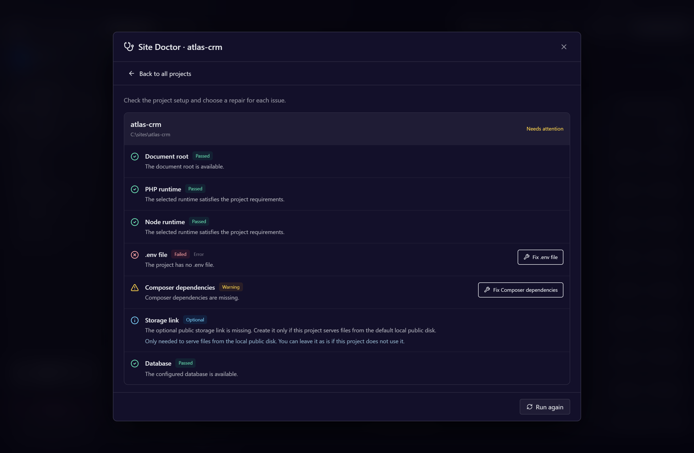

# Site Doctor

Site Doctor inspects the setup of projects registered in LaraEnv and offers individual repairs when their prerequisites are available. It uses each project's effective runtimes, including versions detected from the checkout. See [runtime detection](project-runtime-detection.md).

## Run a diagnosis

On **Projects**, select a row and choose **Doctor** in the details panel. **Run Doctor on all sites** inspects every registered project, including those hidden by the current Projects filter.

The overview shows project counts and health filters, with projects needing attention first. Search by name or path and choose 10, 20 or 50 results per page. Open one project to review its checks. **Back to all projects** preserves the overview's search, health filter, page size and page. **Run again** in the detail rechecks that project and updates the summary counts.

Findings distinguish **Passed**, **Failed**, **Warning**, **Optional** and **Skipped**. A healthy project has no failures or warnings among completed checks. Optional suggestions do not reduce its health. Skipped checks remain unverified; a healthy report does not guarantee every application feature works.

**Manual review** explains what to inspect when no automatic repair is available. A warning can still identify a real problem, such as an unavailable database connection, a missing PHP extension or an incompatible runtime. Dynamic or cached settings and unsupported targets may instead be inspection limits and appear as Skipped.

## Checks and repairs

| Check | What Doctor inspects or offers |
| --- | --- |
| Document root | The directory from which the site should be served. |
| PHP and Node | Runtime resolution and compatibility; filtered Downloads for missing versions. |
| Composer dependencies | `vendor/autoload.php`; installation with the project's PHP when prerequisites are ready. |
| Node dependencies | Installed dependencies and the project's resolved package manager. |
| Laravel `.env` | Copy `.env.example` if `.env` is missing; preserve existing files. |
| Laravel application key | Generate an absent key when PHP and dependencies are ready. |
| Laravel storage link | An optional `public/storage` check and **Create link** action. |
| WordPress configuration | Presence and recognized readable settings in `wp-config.php`; missing configuration needs manual setup. |
| Database | Supported local connection probing and creation of a confirmed missing database. |
| Laravel migrations | Pending migrations; execution requires explicit confirmation. |
| Virtual host | Compare against LaraEnv's generated configuration; replacement of custom configuration requires confirmation. |
| Hosts file | Local-name entries and their available update action. |
| PHP-FPM | The pools needed to serve the project and their available Start action. |

Repairs run individually, not as a batch. Finishing a repair rechecks the affected project and preserves the other reports. Fixing a prerequisite can make later repairs available. Paused projects retain file checks but do not offer repairs; checks dependent on active serving or database access are skipped.

## Storage is optional

Laravel's standard `public/storage` link serves files in `storage/app/public`. Projects that do not use that local public disk can leave the suggestion unchanged and still be healthy.

Symbolic links and Windows junctions pointing to that standard destination are accepted. Doctor preserves an existing directory, file, or link to a different destination. Review it only if the project needs the standard public disk. **Create link** runs Laravel's `storage:link`; it is not mandatory for every Laravel project.

## Database inspection limits

Doctor uses the effective PHP and recognized literal project configuration without loading the application. It preserves the project's database credentials. Automatic creation is limited to local MySQL/PostgreSQL hosts (`localhost`, `127.0.0.1`, `::1`) on their default ports, 3306 and 5432. The configured user must have creation permission. SQLite inspection identifies the configured file and does not create a database.

External databases, valid non-default ports, unsupported names and dynamic settings remain unverified. Invalid ports receive configuration guidance. Laravel's `bootstrap/cache/config.php` prevents Doctor from inferring the active connection from `.env`; cached settings also disable automatic key generation. Calculated WordPress settings or values loaded from other files are not executed to discover credentials.

Recognized connection, authentication and missing-database failures require attention. Unknown client, TLS or query errors, invalid probe results and unavailable probes appear as **Skipped** and do not unlock database creation or migrations. This prevents an inspection limitation from being reported as a confirmed stopped server.

Migrations can change database structure and data. Their repair opens a specific confirmation before running; cancelling that confirmation leaves the database untouched.

## Output, cancellation and Downloads

Repair output streams inside the modal and remains available afterward, including on failure. **Cancel repair** requests interruption; the modal stays open until the command finishes. Cancelling does not undo steps already completed. Returning to the overview collapses output to leave room for the list; **Repair output** opens the saved output again.

Output is bounded and indicates truncation when its limit is reached. Findings summarize configuration and database probes without showing `.env` contents or database credentials.

**Open PHP/Node downloads** filters Downloads to the runtime and, when available, a suggested compatible version. Opening Downloads does not install anything. After installation, run the diagnosis again.

A runtime supplied only by the system PATH is unverified because LaraEnv does not manage its version. When a required command is confirmed missing, select or install a managed PHP/Node version and recheck. If a project cannot be inspected during the all-project run, its finding remains in the report while the other results remain available.
